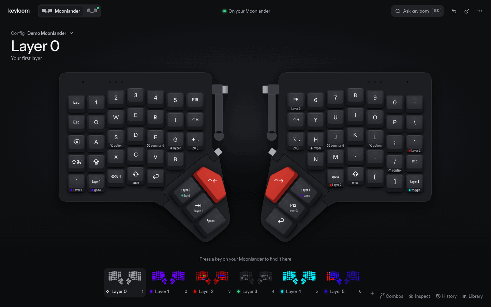
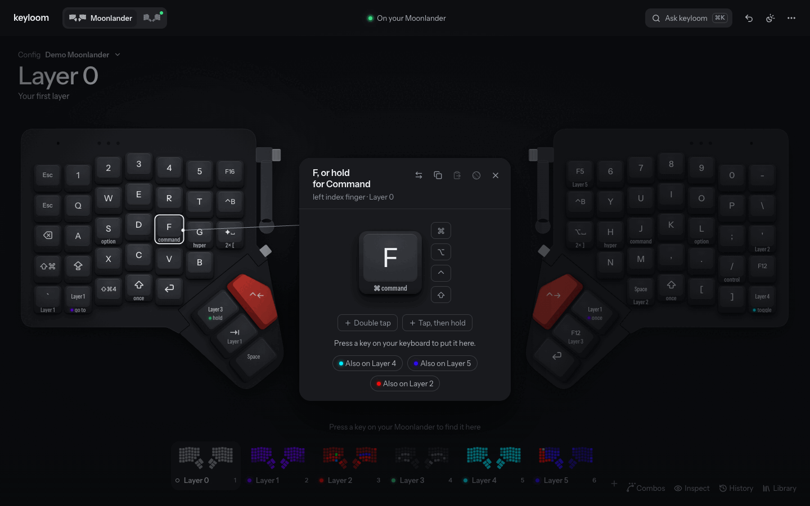
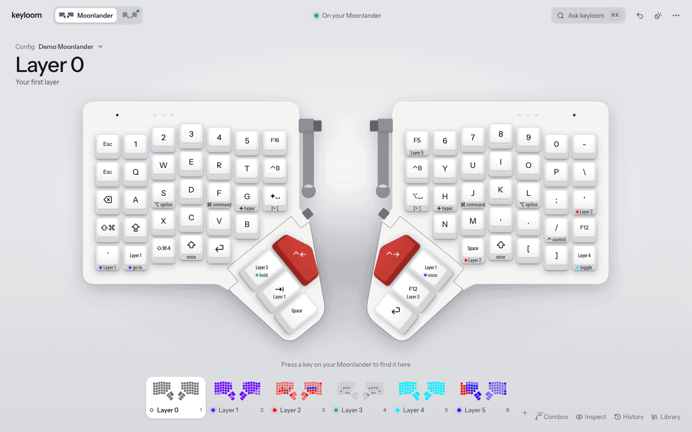
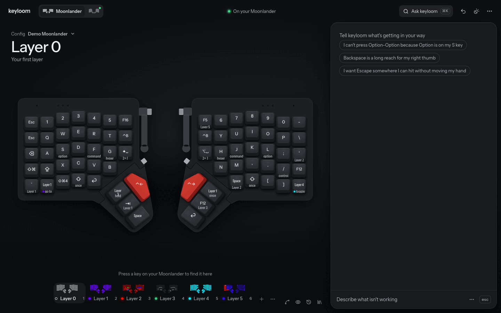
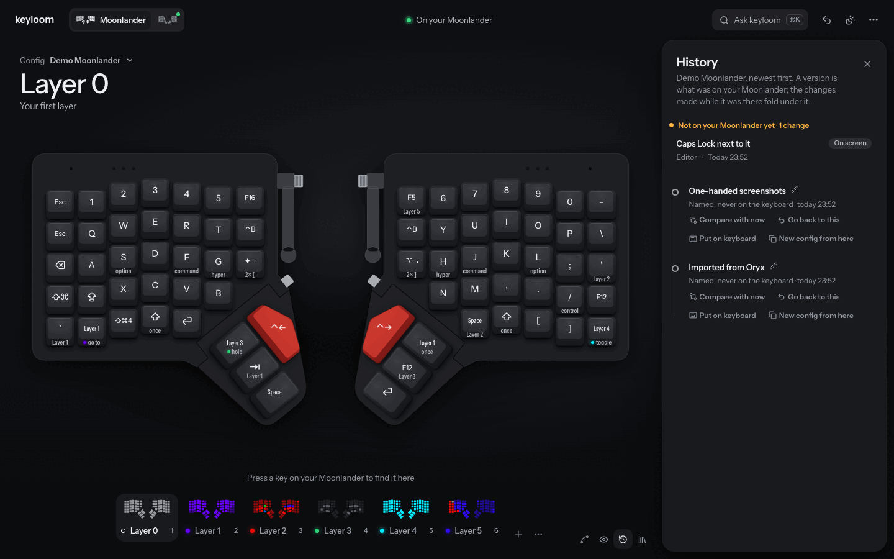
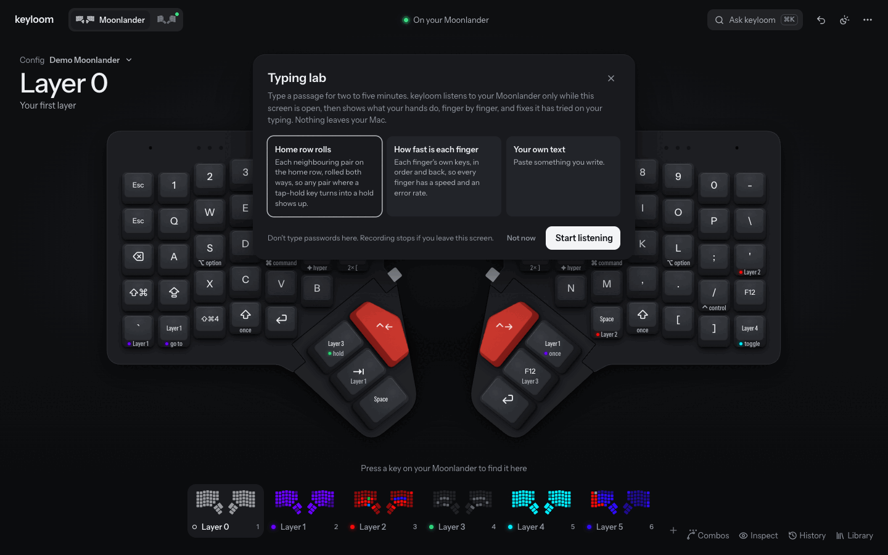
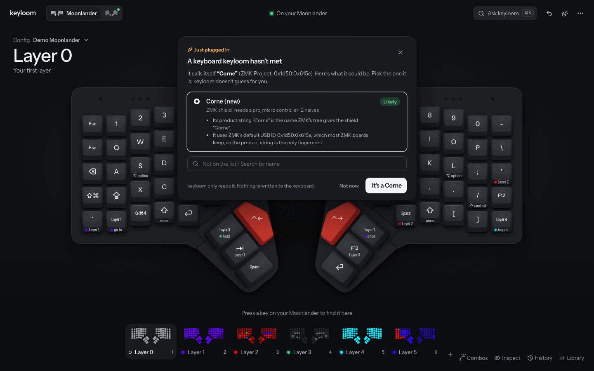
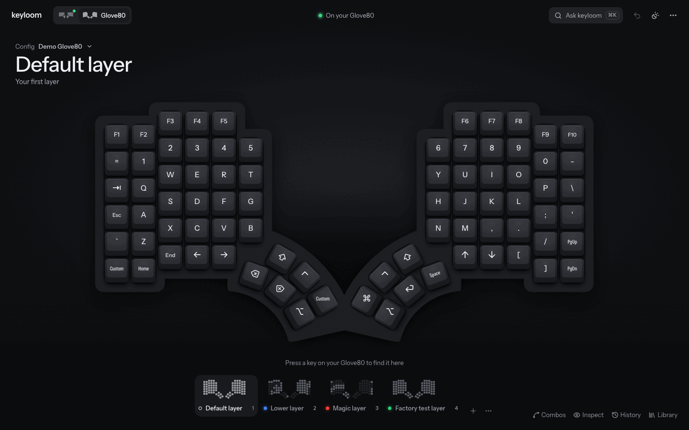

# keyloom

keyloom is a local-first configurator for QMK and ZMK keyboards, and for the MacBook's built-in keyboard, with an AI agent that proposes layout changes you can preview on the keys.



## What you can do

- Configure any QMK or ZMK keyboard, and the MacBook keyboard, from one app.
- Click a key and change it. Tap, hold, double-tap and tap-then-hold are slots on the key, and macros and combos are made on the board.
- Have changes reach the keyboard without touching it, where the board supports that.
- Tell the AI what's in your way. It proposes changes, and you preview them on the keys before accepting.
- Copy a setup from one of your boards to another, even when the keys differ.
- Keep several configs per board, with a version history you can go back to.
- Use the typing lab. It records you typing, measures each finger, and tests home-row-mod timings on the recording.
- Plug in a new keyboard and put your config on it.

## The main screens

Click a key and a card opens beside it. This one is a hold-tap key: F when tapped, Command when held.



The same board in the light theme.



Press ⌘K to open the conversation column. Describe what's wrong, or pick a suggestion.



History shows what was on the keyboard and when. You can name a version, compare it with now, or go back to it.



The typing lab starts from a short card. Typing stays on your machine.



When you plug in a keyboard keyloom hasn't met, it asks which one it is.



The Glove80 gets the same editor.



The screenshots use keyloom's test fixtures and fake keyboards; nothing in them is connected to a real keyboard.

## Install

```sh
curl -fsSL https://raw.githubusercontent.com/planetaryescape/keyloom/main/install.sh | sh
```

The script downloads the binary for your machine from the latest GitHub release, checks it against `SHA256SUMS`, and puts it in `~/.local/bin`. Releases exist for macOS (Apple silicon and Intel) and Linux (x64). Add `--version vX.Y.Z` to pin a release.

Then start the app:

```sh
keyloom serve
```

This opens the web app at `http://127.0.0.1:4477`. Use `--port` to change the port and `--no-open` to skip opening the browser.

Building firmware needs Docker. Flashing a Moonlander needs [Zapp](https://github.com/zsa/zapp). `keyloom doctor` checks both.

To start from your existing layout, import it:

```sh
keyloom import --board zsa/moonlander ~/Downloads/oryx-source.zip
keyloom import --board moergo/glove80 ~/Downloads/layout.keymap
```

## Supported boards

| Board | Firmware | Import from | Flashing | Per-key colours |
|---|---|---|---|---|
| ZSA Moonlander (rev A and B) | QMK | Oryx source zip | Zapp. Hands-free once a keyloom build is on the board | Yes |
| MoErgo Glove80 | ZMK | Layout Editor `.keymap` | UF2 drive per half. keyloom's `keyloom-zmk` module lets it restart each half into the bootloader itself after one manual flash | No: its lights show one effect across all keys |
| foostan Corne | ZMK | ZMK `.keymap` | The same as the Glove80 | No |
| MacBook built-in keyboard (ANSI) | kanata | Karabiner `karabiner.json` (read only) | No flashing. keyloom writes a kanata config and reloads it | No: macOS controls the backlight |

Other boards are added as a folder under `boards/`, with no code. The MacBook board needs [kanata](https://github.com/jtroo/kanata) and a one-time setup; `keyloom remap --help` lists the steps.

For a keyboard that isn't in the table, `keyloom keyboard detect` reads USB and names QMK and ZMK boards from keyloom's index of both firmware trees. `keyloom keyboard add` builds a board definition from it. `keyloom keyboard put` then proposes your config on it, and applies nothing. QMK `atmel-dfu`, `stm32-dfu` and `caterina` recipes use your installed DFU tools; unsupported bootloaders remain manual. Those recipes have been tested with fake tools, not physical keyboards.

The typing lab, new-keyboard detection and its screens have so far been exercised on fake keyboards, not physical ones.

## AI providers

The agent runs on one of three providers.

| Provider | What it needs |
|---|---|
| Anthropic | `ANTHROPIC_API_KEY` in the environment |
| OpenRouter | `OPENROUTER_API_KEY` in the environment |
| Codex CLI | The `codex` CLI installed and signed in with `codex login` |

keyloom uses the first provider it finds a credential for. Pick one with `--provider` on `chat` or `serve`, or set `agent.provider` in `config.json` in the data directory. keyloom never stores your key. A conversation stays on the provider that started it.

The agent only proposes. A validator checks every change set against the board and the layout, and nothing is applied until you accept it.

## The CLI

Everything the web app does has a CLI command. Output is a table in a terminal and JSON when piped.

| Command | What it does |
|---|---|
| `keyloom import` | Import a layout |
| `keyloom layout`, `boards`, `config`, `version` | List layouts and boards, manage configs, and move between versions |
| `keyloom chat` | Talk to the agent from the terminal |
| `keyloom agent show` | Inspect saved agent work without executing it again |
| `keyloom change` | Check, propose and apply changes |
| `keyloom undo` | Take back the last revision |
| `keyloom build`, `flash`, `sync` | Build firmware, flash it, and show where each keyboard stands |
| `keyloom remap` | Set up and manage the MacBook keyboard through kanata |
| `keyloom keyboard` | Detect, add and put a config on a new keyboard |
| `keyloom lab` | Record typing, analyse it, and turn suggestions into proposed changes |
| `keyloom emulate` | Print what a layout would send for a sequence of key presses, using the real firmware logic |
| `keyloom doctor` | Check the database, Docker, Zapp and firmware checkouts |

Run `keyloom --help` for the rest. Use `--data-dir <path>` to work in a scratch directory.

The audit candidate also supports `layout export <layout> --out <file.json>` and reimporting that keyloom document as a new config; see the [CLI reference](docs/blueprint/10-cli.md#export-a-layout-and-import-it-as-a-new-config). Candidate changes are not yet released. Agents can follow [skills/keyloom/SKILL.md](skills/keyloom/SKILL.md) for the checked-proposal loop and hardware safeguards.

## Privacy

keyloom runs on your machine. There is no account and no hosted backend. Layouts, history, conversations and typing sessions live in a local SQLite database in `$XDG_DATA_HOME/keyloom`.

Network traffic happens only in these cases:

- Chat sends your messages, the layouts and board descriptions the agent reads, and your recorded decisions to the provider you picked.
- Typing lab recordings never go to a model. The agent sees aggregated findings and key names, never the passage, the typed text or the raw recording.
- Building firmware fetches pinned firmware sources and Docker images.
- Board geometry/default-keymap lookups can fetch pinned source files. `doctor` reads provider model metadata to check configured API keys, without generating text.

## Learn more

- [docs/blueprint](docs/blueprint/README.md) is the design: the architecture, the layout model, the agent, each board and firmware, and the decisions behind them.
- [CONTRIBUTING.md](CONTRIBUTING.md) explains how to add a keyboard. In Claude Code, the `/add-keyboard` skill in `.claude/skills/add-keyboard/SKILL.md` walks you through it.

## License

keyloom is licensed under [AGPL-3.0-or-later](LICENSE). Contributions are accepted under the same license.
