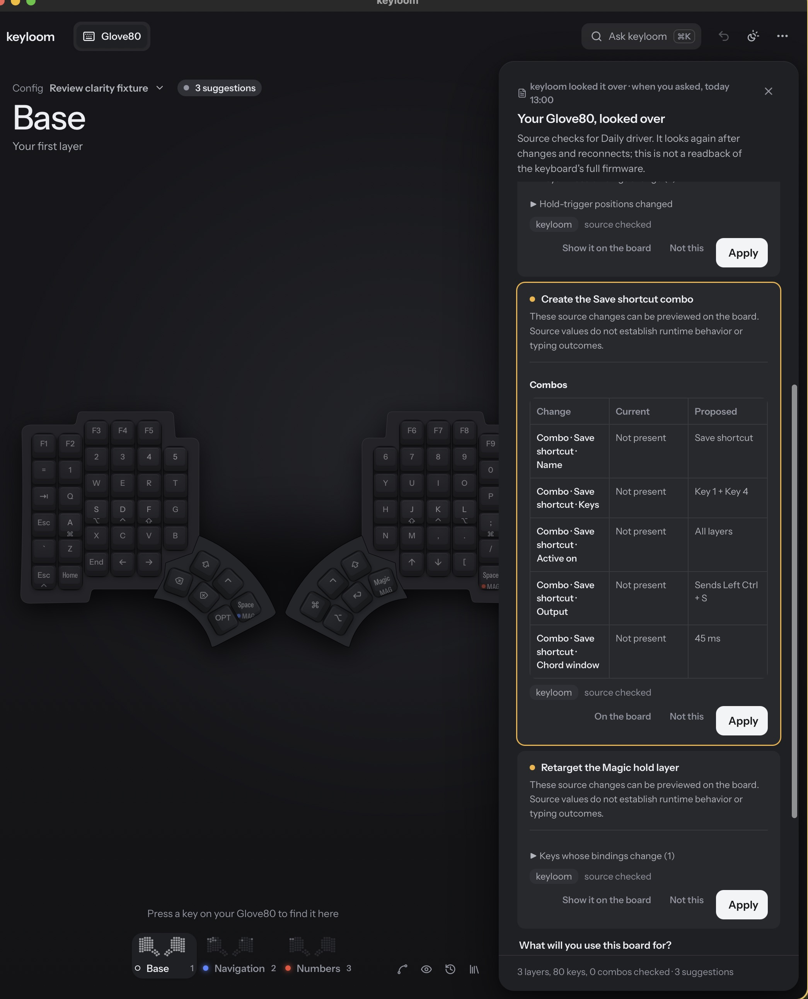

# Rung 1 review clarity evidence

The six screenshots below are from the synthetic full-App/Viewer source fixture, not a released binary. Its proposals API supplies three validated Glove80/ZMK proposals: a tap/hold profile and key change, a Save shortcut combo, and a native hold-layer retarget. Navigation and Numbers deliberately share the `MAG` legend, so the retarget changes the displayed effect without changing the keycap. The source-fixture browser run checks all six viewport/theme states, the combo's chord, scope, output and timeout, and native tap/hold effects. It also previews the profile proposal without changing the source revision, then activates Apply with Enter and checks the synthetic saved layout against the proposal ops.

| Viewport | Light | Dark |
|---|---|---|
| 1440×900 | [screenshot](1440-900-light.png) | [screenshot](1440-900-dark.png) |
| 1100×577 | [screenshot](1100-577-light.png) | [screenshot](1100-577-dark.png) |
| 390×844 | [screenshot](390-844-light.png) | [screenshot](390-844-dark.png) |

[Pinned keyboard preview before Apply](preview-before-apply.png)

## Released and installed evidence

The v0.68.4 released frontend was separately exercised with an installed-release static server and a synthetic `FakeEditor` API proxy. Its browser replay passed the six viewport/theme states, combo and same-legend native comparisons, read-only preview, and Enter-to-Apply with the exact synthetic ops. The [release receipt](release-v0.68.4.json) separates that proof from the source-fixture screenshots above.

This crop comes from an isolated v0.68.4 launch with real data and device-helper access denied. The comparison was visible, but the accessibility driver timed out. This is visual evidence only; it does not prove automated native interaction or Apply. The released-frontend browser replay is the full interaction proof.

The current installed CLI and sidecar are v0.70.0. A separate scratch smoke used a deterministic in-process fake provider to generate a timing-profile review, then exercised the installed CLI's human and JSON `review show` and `change show` output. It showed `Home row · Tapping term: 200 ms → 240 ms`, kept the proposal linked, and left the head and layout document unchanged. This is current v0.70.0 CLI evidence, not a v0.68.4 CLI smoke. Full commands and output were retained with the local closeout evidence.

| Additional comparison evidence | Screenshot |
|---|---|
| Combo values | [desktop combo comparison](combo-comparison.png) |
| Same-legend native retarget | [native effect comparison](native-retarget-comparison.png) |
| Phone comparison after scrolling to its controls | [390×844 scrolled comparison](390-844-scrolled-comparison-controls.png) |

The source-fixture browser run checked panel bounds and overflow at 1440×900, 1100×577 and 390×844 in light and dark themes. The phone panel scrolls internally while the keyboard stays behind it; its scrolled screenshot shows the combo's chord-window value and Apply together. The desktop comparison shows all combo fields. UI tests also verify that a valid sensor edit and a moved unknown native binding are marked incomplete, omit “source checked”, and disable preview and Apply.

All review data in these checks was synthetic. The v0.70.0 CLI setup used the existing scripted fake adapter; no live provider, firmware build, physical keyboard or real config was involved. Source comparisons do not prove runtime behavior, typing speed or comfort. The native AX timeout and lack of native Apply automation remain limitations.
